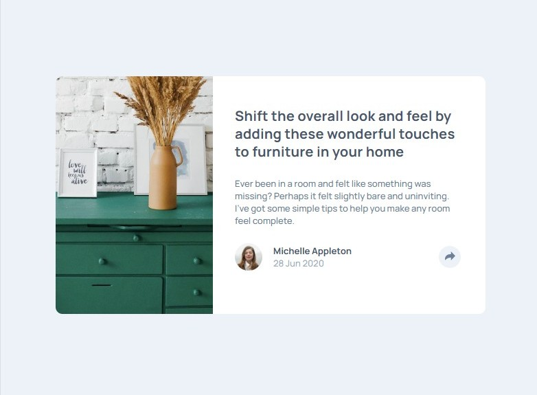

# Frontend Mentor - Article preview component

## Overview

For this challenge, I built and deployed Frontend Mentor's Article preview component. This challenge involves clicking a share button to reveal social links, with a layout that adapts across screen sizes. Frontend Mentor provided all the necessary assets, including images, a Figma file, and a comprehensive style guide.

[Frontend Mentor Article preview component challenge](https://www.frontendmentor.io/challenges/article-preview-component-dYBN_pYFT)

This challenge required knowledge of CSS, Flexbox, JavaScript, semantic HTML, and responsive web design.

### Screenshot

### Links

- Solution URL: [github repository](https://github.com/ClassPython/fem-article-preview-component)
- Live Site URL: [github-pages](https://classpython.github.io/fem-article-preview-component/)

### Built with

- Semantic HTML5 markup
- CSS Flexbox
- JavaScript
- Mobile first design

### What I learned

- The biggest challenges were:
	* Creating a responsive "social media share links" menu for both mobile and desktop views.
	* Hovering the "social media share links" menu over the share button in desktop view while the page width changes.
- **Social media share links menu:** Created a share links menu for both mobile and desktop in HTML, then utilized JavaScript, media queries, and CSS properties to hide and display the correct menu for the appropriate screen width.
- **Hovering social media share links:** Utilized CSS and media queries to create a bubble and properly place an upside-down triangle to create the image of a rectangular bubble. This involved the use of absolute and relative positions.

 ### Next Steps

- Complete the five remaining projects in Frontend Mentor's "JavaScript Fundamentals" learning path.
- Focus on building a project emphasizing managing forms with JavaScript.

